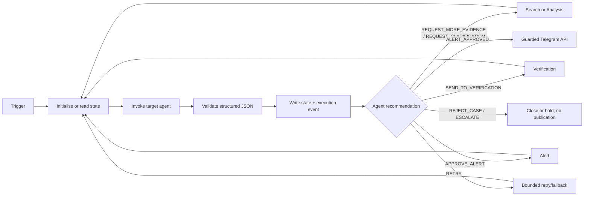

# Phase 3 — System Integration, n8n, Docker, and Telegram

## Your Job

Your job is to make the four independently implemented AI agents work together as one functioning system.

You own the integration layer, not the agents' reasoning. n8n receives their structured decisions, validates them, stores shared case state, routes to the next agent, handles retry limits, logs execution, and posts a fully approved alert through Telegram.

## What the System Does

1. Scam Search collects source-backed evidence.
2. Scam Analysis interprets evidence and can ask for more research.
3. Verification judges whether public claims are sufficiently supported and can send work back.
4. Scam Alert drafts evidence-bounded public text.
5. n8n calls Telegram only after valid verification and alert approvals.

Docker Desktop runs n8n locally. Telegram is a voluntary public channel; users join it themselves.

## Prerequisites

- Docker Desktop
- Git
- n8n Docker image
- LLM provider credential
- Chosen search/web API credential
- Telegram Bot token and a Telegram test/public channel

Keep secrets in `.env` or n8n credentials, never Git. Use placeholders only in documentation:

```text
LLM_API_KEY=
SEARCH_API_KEY=
TELEGRAM_BOT_TOKEN=
TELEGRAM_CHANNEL_ID=
```

## Docker Setup

Create `docker-compose.yml`:

```yaml
services:
  n8n:
    image: n8nio/n8n:latest
    ports:
      - "5678:5678"
    env_file: .env
    volumes:
      - n8n_data:/home/node/.n8n
volumes:
  n8n_data:
```

Start Docker Desktop, then run:

```powershell
docker compose up -d
docker compose logs n8n
```

Open `http://localhost:5678`. Restart with `docker compose restart n8n`. Stop while preserving the named volume with `docker compose down`.

## Shared Case State

Create one state record per `case_id`. At minimum it must hold:

```json
{
  "case_id": "SCAM-001",
  "state_version": 1,
  "sources": [],
  "evidence": [],
  "indicators": [],
  "analysis": null,
  "confidence": {"search": null, "analysis": null, "verification": null, "alert": null},
  "verification_status": "IN_PROGRESS",
  "conflicts": [],
  "missing_information": [],
  "requested_actions": [],
  "agent_history": [],
  "revision_count": 0,
  "research_count": 0,
  "retry_counts": {"search": 0, "telegram": 0},
  "final_alert": null
}
```

Agents receive snapshots and return a patch/message. n8n checks `state_version`, validates schema, appends provenance/history, increments counters, and saves the next version. Do not let an agent overwrite the whole state object.

## n8n Workflow

Build these logical components:

1. Trigger: manual form/webhook or scheduled discovery.
2. Case Initialiser: create `case_id` and state.
3. State Read/Write: use a documented data store/database.
4. Agent Invocation: call each Phase 1/2 subworkflow.
5. Structured Output Parser: validate required JSON fields.
6. Decision Router: route only known actions.
7. Retry and Limit Guard: enforce research/revision/tool retry maximums.
8. Telegram Sender: post only after guards pass.
9. Log Writer: persist all events and tool outcomes.



## Dynamic Routing Rules

| Agent decision | n8n route |
|---|---|
| `REQUEST_MORE_EVIDENCE` | Search Agent |
| `REQUEST_CLARIFICATION` | Named target agent |
| `SEND_TO_VERIFICATION` | Verification Agent |
| `APPROVE_ALERT` | Alert Agent |
| `REJECT_CASE` | Close case; never call Telegram |
| `REQUEST_REVISION` | Responsible previous agent |
| `RETRY` | Retry/fallback only within configured limit |
| `ESCALATE` | Hold for human review; never call Telegram |
| `ALERT_APPROVED` | Check publication guard then Telegram |

The decision must originate in a validated agent message. n8n must not decide whether evidence is sufficient.

## Prevent Infinite Loops

Set and document `MAX_RESEARCH_ATTEMPTS`, `MAX_REVISIONS`, and `MAX_TOOL_RETRIES`. Before re-entering any loop, check the relevant counter. If a maximum is reached, save a final `HELD_FOR_REVIEW` or `REJECTED` outcome with the reason and stop publication.

## Telegram Setup

1. Create a bot through BotFather.
2. Store its token in n8n credentials.
3. Create a public test channel.
4. Add the bot as an administrator with permission to post.
5. Configure the channel ID in secret configuration.
6. Send a harmless test message.
7. Add a publication guard requiring all of:
   - `verification_status = APPROVED`
   - `publication_eligible = true`
   - message type `ALERT_APPROVED`
   - evidence references in `final_alert`

If the API fails, do not call the case published. Log the error, retry within limit, then mark `PUBLICATION_FAILED` for review.

## End-to-End Tests

Run and keep actual execution evidence for:

- Successful verification with safe fixture.
- Insufficient evidence: Analysis returns the case to Search.
- Conflicting sources: Verification returns targeted research request.
- Malformed model JSON: parser sends repair/retry/hold route.
- Search API failure: bounded retry then hold.
- Telegram failure: publication failure recorded.
- Prompt injection in retrieved text: stored as data and never obeyed.

## Actual Execution Trace

After a real test run, export the n8n execution and retain state versions, messages, route choices, counters, tool results, and Telegram test-channel result. Label it **Actual Execution Evidence** only after it has genuinely been captured. Do not use illustrative diagrams or manually written examples as proof of execution.

## Definition of Done

Phase 3 is complete when all four agents can exchange validated messages through n8n, feedback loops are bounded and observable, state persists across runs, all publication guards work, a Telegram test message is delivered from an approved safe fixture, and a real execution trace is captured.
