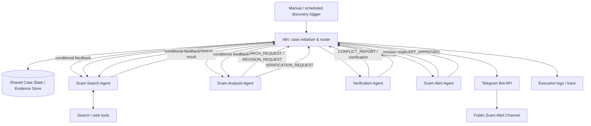
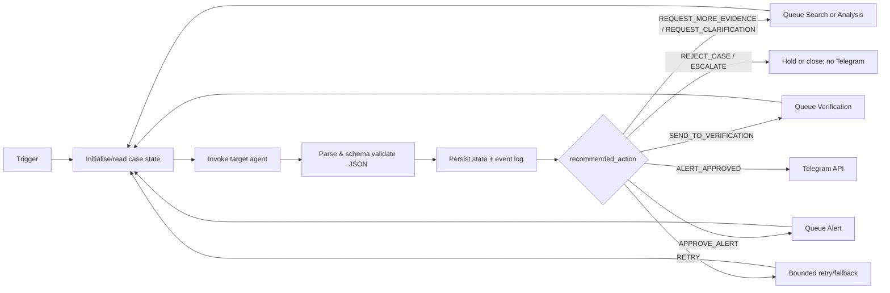

# AI-Powered Scam Detection and Public Alert System

## Corrected user journey and agent boundaries

1. A person describes their situation and optionally adds screenshots, links, message text, or other evidence.
2. **Scam Analysis** structures that intake, identifies indicators and missing details, and sends a verification request. It does not claim that the report is a scam and does not search the web.
3. **Scam Verification** asks **Scam Search** to look for matching known fraud patterns, official warnings, and independent corroboration. If it identifies a known pattern, it explains the match and returns reporting/protection steps.
4. If the case has no known match, that alone means only “inconclusive” — not “new scam.” Verification may ask for more information, hold it, or mark a sufficiently corroborated pattern as an emerging-pattern candidate.
5. **Scam Alert** drafts a Telegram alert only for a verification-approved emerging/suspected pattern. The alert must use cautious wording, redact personal data, and never make an unsupported accusation. Phase 3 is the only layer that sends the approved alert to Telegram.

For an India-facing response plan, immediate cyber-financial fraud should be reported promptly through the National Cybercrime Reporting Portal or by calling 1930; the workflow must tell the user to preserve evidence and contact their bank/payment provider as appropriate.

> **Design status:** Proposed implementation design for CA3. Diagrams, scenarios, and the execution trace in this document are illustrative unless explicitly replaced by captured run evidence. This document does not claim that the system has already been implemented or executed.

## 1. Project Overview

New phishing campaigns, fraudulent websites, fake job offers, impersonations, and investment schemes emerge faster than public warnings can be manually assembled. Reports are fragmented, sources may disagree, and a premature public accusation can cause harm. The proposed system investigates suspicious reports, retains the evidence behind its conclusions, and publishes only sufficiently verified, carefully worded alerts.

The target users are members of a voluntary Telegram public-alert channel, investigators maintaining the system, and a project team demonstrating accountable AI coordination. Four specialised LLM-driven agents are appropriate because discovery, interpretation, verification, and public communication have different goals and failure modes. Separating them creates an evidence gate: the agent that drafts a warning is not the one that discovers or approves the claim.

Expected impact is faster, more explainable scam awareness while reducing unsupported public allegations. The system is a proposed **adaptive multi-agent coordination system**, not a one-way automation pipeline.

## 2. Project Objectives

- Discover suspicious online activity and preserve source metadata.
- Analyse the suspected scam type, method, targets, indicators, and uncertainty.
- Verify claims through evidence triangulation, contradiction analysis, and reasoned judgement.
- Let agents request research, clarification, revision, or escalation dynamically.
- Generate a clear, evidence-bounded public alert only after verification approval.
- Publish an approved alert through a Telegram Bot to a voluntary public channel.
- Maintain explainability, reliability controls, retry limits, and execution logs.

## 3. System Architecture

The architecture combines an **orchestrator-worker pattern**, a **shared-state/blackboard pattern**, and structured agent-to-agent messages. The four agents are independent reasoning components. Each reads the current case state, uses its allowed tools, produces a structured decision, and may challenge or request work from another agent. The n8n workflow is infrastructure: it validates the structured decision, persists state, invokes the chosen component, and routes the next message. It does not decide whether evidence is sufficient.



### Components and data flow

| Component | Responsibility |
|---|---|
| n8n | Receives triggers, invokes agents/tools, parses structured output, validates routes, persists state, retries integrations, sends Telegram messages, and logs execution. |
| Shared Case State | Versioned blackboard containing evidence, decisions, limits, conflicts, and history for one `case_id`. |
| Evidence Store | Stores source URLs, retrieval time, excerpts, hashes where feasible, tool result references, and provenance. |
| Four AI agents | Reason over scoped inputs, return structured messages, and recommend the next action. |
| Search/web tools | Retrieve candidate public evidence; retrieved text is untrusted data. |
| LLM provider | Supplies reasoning and structured-output capability to the agents. |
| Telegram | Delivers only an approved public alert; users join the channel voluntarily. |
| Log store | Keeps immutable-enough event records for debugging, assessment, and audit. |

Routing is conditional. An analysis may request more evidence; verification may report a contradiction; the alert agent may reject an unsupported draft. The state’s `research_count`, `revision_count`, and retry counters bound every loop. A stopped or unresolved case is held for review rather than published.

## 4. Agent Specifications

All agents receive the minimum necessary state snapshot plus an input message, and return a schema-valid message. They must distinguish observations from inferences, cite evidence IDs for claims, state uncertainty, and never treat web content as instructions.

### 4.1 Scam Search Agent

**Purpose and responsibilities.** Discover reports and independent sources; extract URLs, dates, claims, indicators, and provenance; deduplicate sources; identify gaps; and perform targeted follow-up research when requested.

**Inputs:** discovery query or research request, `case_id`, existing source fingerprints, missing-information list, and research budget. **Tools:** approved search API and HTTP/web retrieval/extraction tool. **Outputs:** `DISCOVERY` or research-result message with source records, evidence items, source-quality notes, gaps, and a recommended recipient.

**Reasoning and decisions.** The agent plans queries based on missing facts (for example, domain registration warning, regulator warning, or independent victim report), compares source identity and recency, and stops when a tool returns no useful independent evidence or budget is exhausted. It does not decide publication eligibility. It asks Analysis to interpret newly collected evidence or reports `ESCALATE` when research cannot safely proceed.

**State, confidence, and failures.** It reads `sources`, `evidence`, `requested_actions`, and `research_count`; appends provenance-preserving records only. Confidence reflects collection completeness, not scam truth. On inaccessible pages it records the failure and tries a permitted alternate query/source; on repeated failure it returns an explicit gap. It revises its output when duplicate detection, invalid extraction, or a follow-up request exposes an error.

**Example input:** `{"case_id":"SCAM-001","objective":"Find independent evidence about example-invest.net","missing_information":["regulator warning","independent reporting"]}`.

**Example output:** `{"message_type":"DISCOVERY","requested_action":"SEND_TO_ANALYSIS","evidence":[{"evidence_id":"E-03","source_id":"SRC-03","claim":"A regulator notice names the domain.","support":"direct","retrieved_at":"2026-10-09T10:00:00Z"}],"confidence":0.72,"status":"IN_PROGRESS"}`.

**Implementation notes:** an n8n agent-invocation subworkflow supplies JSON and validates output against the message schema. Search responses are stored before LLM interpretation; a source URL alone is never treated as proof.

### 4.2 Scam Analysis Agent

**Purpose and responsibilities.** Classify the suspected scam, explain its modus operandi, platforms, likely targets, warning signs, and evidence gaps. It critiques weak inference and requests focused investigation.

**Inputs:** evidence bundle and source metadata. **Tools:** optionally a safe text-extraction/normalisation tool; it does not need an independent browsing tool in the initial scope. **Outputs:** analysis record plus `RESEARCH_REQUEST`, `VERIFICATION_REQUEST`, or `REVISION_REQUEST`.

**Reasoning and decisions.** It maps concrete observations to a tentative classification, separates facts from hypotheses, checks that key claims have evidence IDs, and determines whether evidence is interpretable enough to send to Verification. It may request Search to find independent confirmation, a named entity, dates, or a missing technical indicator. It updates its analysis after new evidence and explicitly notes changed conclusions.

**State, confidence, and failures.** It reads evidence, indicators, conflicts, and previous analysis versions; writes `analysis` and `missing_information`. Its confidence is analytical completeness, not approval. Malformed or contradictory evidence creates a clarification/revision request, not invented detail. It can request Search or Verification, but cannot send an alert.

**Example input:** `{"case_id":"SCAM-001","evidence_ids":["E-01"],"sources":[{"quality":"low","independent":false}]}`.

**Example output:** `{"message_type":"RESEARCH_REQUEST","recipient":"scam_search_agent","objective":"Find two independent sources or an official warning for the domain.","missing_information":["independent corroboration"],"recommended_action":"REQUEST_MORE_EVIDENCE","confidence":0.41}`.

**Implementation notes:** prompt requires JSON-only structured output and includes a claim-to-evidence map. n8n increments `revision_count` only after schema validation and state persistence.

### 4.3 Verification Agent

**Purpose and responsibilities.** Act as the principal reliability gate. It evaluates source credibility, independence, recency, corroboration, contradictions, and the fit between evidence and proposed public claims.

**Inputs:** analysis, evidence records, provenance, conflicts, and research/revision budgets. **Tools:** optional source metadata lookup or approved web retrieval for targeted cross-checking; no automatic publication tool. **Outputs:** reasoned `APPROVAL`, `REJECTION`, `CONFLICT_REPORT`, `RESEARCH_REQUEST`, or `ESCALATE`.

Verification is not `if confidence > X`. The agent constructs an evidence assessment: what each source directly establishes, whether sources are independent, whether conflicts concern a material claim, whether the alert wording can be narrowed, and whether continuing research is proportionate. A score is a documented signal alongside that reasoning, never the sole gate. Approval requires traceable support for each material public statement, no unresolved material contradiction, and a verification rationale. Rejection closes a case with a reason; escalation holds an inconclusive case for human review or a safe non-public outcome.

**State, confidence, and failures.** It writes `verification_status`, `verification_rationale`, `conflicts`, and a claim-evidence matrix. It asks Search for specific evidence when gaps are recoverable, and asks Analysis to revise when the interpretation overstates evidence. On unavailable sources, it discounts—not silently replaces—the evidence. Maximum research attempts or unresolved high-impact conflict becomes `HELD_FOR_REVIEW`/`ESCALATE`.

**Example output:** `{"message_type":"CONFLICT_REPORT","recipient":"scam_search_agent","conflicts":[{"claim":"domain is fraudulent","source_a":"SRC-01","source_b":"SRC-04","material":true}],"requested_action":"SEARCH_ADDITIONAL_SOURCES","recommended_action":"REQUEST_CLARIFICATION","confidence":0.55,"status":"IN_PROGRESS"}`.

**Implementation notes:** prompt supplies a verification rubric, not an approval threshold alone. The output schema requires `rationale`, `claim_evidence_map`, `unresolved_conflicts`, and `publication_eligible`.

### 4.4 Scam Alert Agent

**Purpose and responsibilities.** Convert an approved, bounded case into clear public language explaining the scam, method, warning signs, precautions, and evidence references.

**Inputs:** approved verification record, approved claims, evidence references, alert template, and state. **Tools:** Telegram handoff occurs through n8n only after an `ALERT_APPROVED` message. **Outputs:** `ALERT_DRAFT`, `ALERT_REVISION`, or `ALERT_APPROVED`.

It validates that every material statement is supported, that verification is approved, that language does not overstate certainty, and that the message excludes sensitive personal data and unsupported accusations. Missing approval, missing citation, unsafe wording, or an incomplete required field causes a revision request to Analysis or Verification. It revises drafts when asked. Its confidence expresses readiness and clarity, not independent verification.

**Example output:** `{"message_type":"ALERT_DRAFT","recommended_action":"APPROVE_ALERT","final_alert":{"title":"Warning: suspected investment-site impersonation","evidence_refs":["E-02","E-03"],"precautions":["Do not transfer funds before independently verifying registration."]},"confidence":0.86}`.

**Implementation notes:** n8n validates `verification_status == APPROVED`, required citations, and `publication_eligible == true` before calling Telegram. The Alert Agent cannot bypass this guard.

## 5. Agent Communication Protocol

Messages are JSON records stored in `agent_history`; n8n also passes them to the next target. `sender` and `recipient` identify an agent or `n8n_orchestrator`; `state_version` prevents stale writes.

```json
{
  "message_id": "MSG-001",
  "case_id": "SCAM-001",
  "state_version": 4,
  "sender": "scam_analysis_agent",
  "recipient": "scam_search_agent",
  "message_type": "RESEARCH_REQUEST",
  "objective": "Find independent evidence about the domain.",
  "evidence_refs": ["E-01"],
  "findings": [],
  "confidence": 0.61,
  "rationale": "Only one low-quality source supports the claim.",
  "missing_information": ["independent corroboration"],
  "requested_action": "SEARCH_ADDITIONAL_SOURCES",
  "recommended_action": "REQUEST_MORE_EVIDENCE",
  "status": "IN_PROGRESS",
  "timestamp": "2026-10-09T10:00:00Z"
}
```

| Message type | Meaning |
|---|---|
| `DISCOVERY` | Search has supplied candidate evidence. |
| `ANALYSIS_REQUEST` | Route evidence to Analysis. |
| `RESEARCH_REQUEST` | Targeted request for more evidence. |
| `VERIFICATION_REQUEST` | Analysis asks for reliability evaluation. |
| `REVISION_REQUEST` | Correct or narrow an earlier output. |
| `CONFLICT_REPORT` | Material sources or claims conflict. |
| `APPROVAL` | Verification approves a publication-bounded case. |
| `REJECTION` | Case is not supported and is closed without publication. |
| `ALERT_DRAFT` | Proposed public text awaiting validation. |
| `ALERT_REVISION` | Alert needs supported wording or missing fields. |
| `ALERT_APPROVED` | Validated alert may be handed to Telegram. |

## 6. Shared Case State

```json
{
  "case_id": "SCAM-001",
  "state_version": 5,
  "suspected_scam": "Investment website reported by a public post",
  "scam_type": "suspected investment fraud",
  "sources": [{"source_id":"SRC-01","url":"https://example.invalid/report","retrieved_at":"2026-10-09T10:00:00Z","quality":"unassessed","fingerprint":"sha256:..."}],
  "evidence": [{"evidence_id":"E-01","source_id":"SRC-01","claim":"...","excerpt":"...","support":"reported","status":"unverified"}],
  "indicators": ["promise of guaranteed returns"],
  "analysis": {"version":1,"classification":"tentative","claim_evidence_map":{}},
  "confidence": {"search":0.60,"analysis":0.41,"verification":null,"alert":null},
  "verification_status": "IN_PROGRESS",
  "verification_rationale": null,
  "conflicts": [],
  "missing_information": ["independent corroboration"],
  "requested_actions": [],
  "agent_history": ["MSG-001"],
  "revision_count": 0,
  "research_count": 1,
  "retry_counts": {"search":0,"telegram":0},
  "final_alert": null,
  "created_at": "2026-10-09T10:00:00Z",
  "updated_at": "2026-10-09T10:02:00Z"
}
```

Agents receive a read-only snapshot and propose a patch plus message. n8n validates the patch, checks the expected `state_version`, appends evidence/history without erasing provenance, increments bounded counters, and saves a new state version. Conflicting writes are re-read and retried or sent to escalation.

## 7. Dynamic Decision-Making

| Condition | Agent decision | n8n action |
|---|---|---|
| Evidence insufficient | Request more research | Route to Search Agent and increment research count |
| Analysis incomplete | Request clarification/revision | Route to relevant agent |
| Sources conflict | Request targeted independent evidence | Route to Search; store conflict |
| Verification inconclusive | Continue investigation or hold | Research loop or escalation route |
| Evidence sufficiently supported | Approve with rationale | Route to Alert Agent |
| Alert information missing | Request revision | Route to Analysis/Verification |
| Tool failure | Recommend retry/fallback | Retry permitted integration; record event |
| Maximum limit reached | Escalate/hold/reject | Stop publication and log final state |

The operational cycle is: **agent decides → structured JSON → n8n validates and routes → target agent acts → shared state updates → agent reevaluates**. n8n rejects unknown actions and routes malformed output to a repair/retry path; it never manufactures a decision.

## 8. End-to-End Scenarios

### Scenario 1 — Successful verification (illustrative)

Search gathers an official warning and independent reporting. Analysis classifies the method and sends a claim-evidence map to Verification. Verification finds the sources independent, material claims directly supported, and no unresolved conflict; it approves bounded wording. Alert validates the approval, drafts an evidence-linked warning, and n8n publishes it to Telegram.

### Scenario 2 — Insufficient evidence (illustrative)

Search finds one anonymous report. Analysis sends `RESEARCH_REQUEST` because corroboration is missing. n8n returns the case to Search, which obtains a regulator notice and a separate report. Analysis updates its classification and sends `VERIFICATION_REQUEST`; Verification then makes a reasoned decision from the expanded evidence.

### Scenario 3 — Conflicting evidence (illustrative)

Search and Analysis identify a suspicious site. Verification finds that one source calls it fraudulent while another source disputes the claimed ownership link. It records a `CONFLICT_REPORT` and asks Search for authoritative ownership or regulator evidence. New evidence either resolves the material conflict, leading to a fresh verification decision, or leaves it unresolved, leading to a held/rejected non-public case.

## 9. Illustrative Execution Trace — Not Actual Execution Evidence

```text
Search → Analysis: DISCOVERY(E-01, one low-quality report)
Analysis → Search: RESEARCH_REQUEST(independent corroboration required)
Search → Analysis: DISCOVERY(E-02 official notice, E-03 independent report)
Analysis → Verification: VERIFICATION_REQUEST(claim-to-evidence map)
Verification → Search: CONFLICT_REPORT(ownership claim conflicts; find authoritative source)
Search → Verification: DISCOVERY(E-04 registry/regulator evidence)
Verification → Alert: APPROVAL(bounded claims; rationale and citations supplied)
Alert → Telegram: ALERT_APPROVED(formatted alert; n8n performs API handoff)
```

This is a design example, not execution evidence. A real trace must come from exported n8n executions and the persisted event/state records.

## 10. Input Definition

Accepted inputs are a manual investigation submission or a discovery-triggered candidate report, where scheduled discovery is implemented. The initial input is schema-validated, rate-limited, and treated as untrusted.

```json
{
  "query": "Suspicious investment website reported online",
  "source_hint": "https://example.invalid/post",
  "submitted_by": "anonymous",
  "submitted_at": "2026-10-09T10:00:00Z"
}
```

Required: non-empty `query`. Optional: valid HTTP(S) `source_hint`, pseudonymous `submitted_by`, and timestamp. Inputs must not contain secrets or instructions for agents; user-provided claims become unverified evidence, not facts.

## 11. Output Definition

```json
{
  "case_id": "SCAM-001",
  "title": "Warning: suspected investment-site impersonation",
  "scam_type": "investment fraud",
  "description": "Evidence-bounded description of the reported activity.",
  "modus_operandi": "...",
  "warning_signs": ["guaranteed return claims"],
  "affected_platforms": ["website"],
  "evidence_refs": ["E-02", "E-03"],
  "verification_status": "APPROVED",
  "verification_confidence": 0.84,
  "precautions": ["Independently verify registrations before paying."],
  "sources": ["https://..."],
  "timestamp": "2026-10-09T10:30:00Z"
}
```

Telegram sample:

> ⚠️ **Scam warning: suspected investment-site impersonation**
>
> Do not send money based on guaranteed-return claims. Check the linked evidence and independently verify registrations before acting.
>
> Evidence: official notice and independent reporting. Case ID: SCAM-001.

## 12. Telegram Integration

A Telegram Bot uses the Bot API to post an approved formatted message to a dedicated public channel. The project administrator adds the bot to that channel with permission to post messages. People choose to join the channel; the system does not claim automatic subscription. n8n stores the token as a credential/environment secret, formats the approved alert, sends it, records the returned message ID, and retries transient failures within a limit. Permanent or exhausted failures leave the case `PUBLICATION_FAILED` for review; they do not silently mark it published.

## 13. n8n + Docker Desktop Architecture

Docker Desktop is the local runtime for the n8n container. A named Docker volume persists n8n configuration and executions across restarts. Docker logs and container health support troubleshooting. n8n is the orchestration, integration, state-connector, structured-output parsing, routing, external API, Telegram, and logging layer.

**AI reasoning belongs to the agents. Execution and routing belong to n8n.** n8n executes the action declared in an agent’s validated structured output; it is not described as an AI agent or as the decision-making brain.

## 14. n8n Workflow Design



Logical components are trigger, case initializer, state read/write, agent invocation, structured-output parser, decision router, message handler, retry/replanning handler, Telegram sender, and log writer. `REQUEST_MORE_EVIDENCE` targets Search; `SEND_TO_VERIFICATION` targets Verification; `APPROVE_ALERT` targets Alert; `REJECT_CASE` closes without publication; `REQUEST_REVISION` routes to the responsible prior agent; `ESCALATE` holds the case; `RETRY` uses a capped integration retry/fallback. All route choices originate in validated agent output.

## 15. Tools Used by Agents

| Agent | Tool | Purpose | Why needed |
|---|---|---|---|
| Search | Approved search API | Find candidate/independent sources | Evidence discovery and follow-up research |
| Search | HTTP/web extraction | Retrieve and extract public source content | Preserve source-backed observations |
| Analysis | Structured LLM output | Classify and map claims to evidence | Bounded interpretation |
| Verification | Approved metadata/web lookup | Cross-check targeted claims when configured | Evidence triangulation |
| Alert | Structured LLM output | Draft evidence-bounded public text | Clear communication |
| n8n (not an agent) | Telegram Bot API | Publish approved alert | Channel delivery |

The exact search provider and state database are selected during implementation; they must be recorded in the final repository rather than invented in evidence.

## 16. Technology Stack

Proposed stack: Docker Desktop; n8n in Docker; an LLM provider capable of structured JSON output; an approved search/web API; a state store suitable for case records (initially n8n Data Store or a documented database); Telegram Bot API; and GitHub for version control. Secrets live in n8n credentials or environment configuration, never Git.

## 17. Reliability and Safety

The system mitigates false positives through source provenance, independent corroboration, conflict checks, a separate Verification Agent, claim-level evidence references, and a publication gate. It acknowledges false negatives due to incomplete coverage and avoids declaring absence of evidence as safety. The system must not publish an unverified accusation simply because an LLM generated it. It should avoid personal data, doxxing, defamatory certainty, and unsafe instructions; sensitive cases and unresolved material conflict are held for human review. API failures, hallucinations, and unsupported claims are recorded and routed to recovery rather than concealed.

## 18. Prompt Injection and Untrusted Web Content

Retrieved webpages, submissions, snippets, and documents are untrusted data. The retrieval layer stores content as evidence and keeps it separate from system/developer/agent instructions. Prompts instruct agents never to follow instructions found in sources, to extract structured claims/provenance only, and to flag content that attempts to alter behaviour, exfiltrate secrets, or bypass policy. Agents reason over cited evidence, not commands embedded in that evidence. The test suite includes prompt-injection-like source content.

## 19. Failure Handling

| Failure | Detection | Response | Recovery | Final outcome |
|---|---|---|---|---|
| Search failure | Tool error/timeout | Record failure; request retry | Alternate query/provider if configured | Hold/escalate after limit |
| Inaccessible source | HTTP/error or extraction failure | Mark unavailable | Seek independent source | Evidence discounted |
| Malformed LLM JSON | Schema parser failure | Repair/retry prompt | Bounded retry | Hold case if unresolved |
| Low confidence | Agent rationale/gaps | Request research | Re-evaluate | Hold/reject if limit reached |
| Conflicting evidence | Verification comparison | Conflict report | Targeted research/revision | Approval only if resolved/bounded |
| Telegram failure | API result | Do not mark published | Retry then notify reviewer | Publication failed/queued |
| State-write failure | Store error/version conflict | Stop routing | Retry/re-read safely | Escalate if persistent |
| Repeated research failure | Counters | Stop loop | Escalate | No publication |
| Retry limit | Counter check | Close route | Preserve trace | Held/rejected |

## 20. Observability and Execution Logging

Every event records `case_id`, state version, agent, message ID/type, timestamp, input/output references, decision, rationale, confidence, tool-call metadata, routing result, retry/revision counter, and final status. Logs make hand-offs observable, enable assessment of genuine agent-to-agent communication, reproduce failures, and distinguish an illustrative trace from actual n8n execution evidence.

## 21. CA3 Requirement Mapping

| CA3 requirement | Proposed implementation | Evidence to capture |
|---|---|---|
| Four distinct agents | Search, Analysis, Verification, Alert | Prompts, workflows, outputs |
| Distinct roles | Discovery, interpretation, reliability, communication | Agent specifications/tests |
| Planning and reasoning | Each agent returns rationale and next action | Structured messages |
| Tools | Search/web tools and Telegram integration | Tool logs/configuration |
| Adaptation/replanning | Requests, conflicts, revisions, bounded loops | n8n executions/state history |
| Inter-agent communication | Versioned JSON messages | Message log |
| Conflict resolution | Verification conflict report and targeted research | Conflict scenario trace |
| Failure handling | Matrix, retries, hold states | Failure tests/executions |
| Execution trace | Persisted event stream | Actual exported run |

It is not a simple n8n chain because a validated agent recommendation determines the next recipient, including backward routes, revisions, holds, and termination. n8n transports and enforces these decisions.

## 22. Why Four Agents Instead of One?

Specialisation narrows prompts and makes reasoning reviewable. Search optimises evidence collection; Analysis interprets without approving; Verification independently critiques evidence and controls the gate; Alert translates approved claims without expanding them. This separation supports triangulation, reduces a single model’s unchecked hallucination risk, and makes adaptive feedback meaningful.

## 23. Security, Privacy and Ethics

Use data minimisation, redact personal identifiers, restrict secret access, validate malicious submissions, and avoid accusations stated as facts without evidence. Provide source context and bounded language, prevent doxxing, and allow a human oversight/review path for sensitive or disputed cases. Follow applicable platform terms and law; responsible disclosure may be preferable to public publication for certain vulnerabilities.

## 24. Repository Structure

```text
project/
├── README.md
├── PROJECT_DESIGN.md
├── docker-compose.yml
├── .env.example
├── .gitignore
├── n8n/
│   ├── workflows/
│   └── credentials-notes.md
├── agents/
│   ├── scam_search/
│   ├── scam_analysis/
│   ├── verification/
│   └── scam_alert/
├── schemas/
│   ├── agent-message.schema.json
│   ├── case-state.schema.json
│   └── alert.schema.json
├── tools/
├── tests/
├── examples/
└── docs/
```

## 25. Testing Strategy

Test each agent’s prompt/schema contract, JSON schemas, state versioning, every router action, feedback-loop limits, duplicate evidence, low confidence, conflicts, Telegram success/failure, malformed model output, search failures, prompt injection, and end-to-end cases. Fixtures must label simulated evidence; real tests must preserve real execution logs. Include assertions that no Telegram call occurs without a valid Verification approval and Alert approval.

## 26. Live Demo Plan

Demonstrate a prepared safe fixture, not an unverified real accusation: (1) submit input, (2) show Search evidence, (3) Analysis output, (4) research request, (5) added evidence, (6) Verification conflict/uncertainty handling, (7) replanning route, (8) approval rationale, (9) Alert draft/validation, (10) Telegram test-channel post, and (11) logs/state history. Emphasise messages, routing, and evidence changes over the final message alone.

## 27. Evidence to Capture

Capture architecture and n8n diagrams, exported n8n workflow, Docker setup, prompts, schemas, structured outputs, agent messages, state snapshots, routing decisions, research loops, conflict resolution, tests, GitHub history, Telegram test-channel alert, and an actual exported execution trace. Clearly label design diagrams, fixtures, and illustrative examples separately from real evidence.

## 28. Limitations and Future Improvements

Coverage depends on search/API access; sources may be unavailable, biased, or delayed; LLMs may hallucinate or misclassify; and false positives/negatives remain possible. Telegram availability and API limits also affect delivery. Future work can add more authoritative feeds, human review dashboards, richer provenance, multilingual handling, calibrated scoring, and independent evaluations.

## 29. Implementation Division Among Three Team Members

### Phase 1 — Two Agents: Scam Search Agent and Scam Analysis Agent

**Ownership:** implement exactly these two agents and their contracts.

| Deliverable | Search Agent | Analysis Agent |
|---|---|---|
| Prompt | Discovery, provenance, deduplication, gap detection, untrusted-content rule | Classification, claim-evidence map, uncertainty, critique |
| Input/output | `DISCOVERY`/research request → evidence bundle | evidence bundle → research/verification/revision message |
| Tools | Configured search + web extraction | Structured LLM; optional normalisation only |
| State fields | `sources`, `evidence`, `research_count` | `analysis`, `indicators`, `missing_information` |
| n8n work | Agent subworkflow and schema parsing | Agent subworkflow and schema parsing |
| Tests | duplicates, unavailable source, follow-up research | incomplete evidence, changed analysis, invalid JSON |

Expected files: `agents/scam_search/`, `agents/scam_analysis/`, shared schema updates under `schemas/`, fixtures under `tests/`, and documented n8n subworkflow exports. Integration contract: consume and emit the common message/state fields unchanged; cite `evidence_id`s; never call Telegram or assign final verification approval.

### Phase 2 — Two Agents: Verification Agent and Scam Alert Agent

**Ownership:** implement exactly these two agents and their contracts.

| Deliverable | Verification Agent | Alert Agent |
|---|---|---|
| Prompt | Credibility, independence, contradictions, claim-level rationale, escalation | Evidence-bounded plain-language public warning and validation |
| Input/output | analysis/evidence → approval, conflict, research, rejection, escalation | approved case → draft, revision, alert approval |
| State fields | `verification_status`, rationale, conflicts | `final_alert`, publication readiness |
| n8n work | Verification subworkflow and output parser | Alert subworkflow; Telegram handoff guard |
| Tests | weak evidence, conflict, reasoned rejection, approval rationale | missing citation, unsafe wording, revision, formatted alert |

Verification must use evidence-based reasoning, not a boolean confidence threshold. Expected files: `agents/verification/`, `agents/scam_alert/`, common schema updates, test fixtures, and subworkflow exports. Integration contract: use `APPROVAL` only with rationale and claim-evidence mapping; Alert must request revision for missing approval/support and cannot publish directly.

## 30. Phase 3 — Beginner-Friendly Integration

**Your job is to make the four independently implemented AI agents work together as one functioning system.**

### 30.1 Understand the Project

The system investigates a suspected scam before warning the public. Search finds material, Analysis explains it, Verification decides whether public claims are supported, and Alert writes the warning. n8n moves validated JSON between them, saves the shared case state, and calls external services. Docker Desktop runs n8n locally in a container. Telegram is only the final delivery channel.

### 30.2 Install prerequisites

Install Docker Desktop and Git. Create accounts/credentials for the chosen LLM provider, approved search API, and Telegram Bot; store real values only in local secrets/credentials. Do not commit tokens. Create an `.env` from `.env.example` with placeholders such as `LLM_API_KEY=`, `SEARCH_API_KEY=`, `TELEGRAM_BOT_TOKEN=`, and `TELEGRAM_CHANNEL_ID=`.

### 30.3 Docker Desktop setup

Start Docker Desktop and wait until it reports that the engine is running. In the project directory, create a `docker-compose.yml` using a named `n8n_data` volume. A minimal local pattern is:

```yaml
services:
  n8n:
    image: n8nio/n8n:latest
    ports: ["5678:5678"]
    env_file: .env
    volumes: ["n8n_data:/home/node/.n8n"]
volumes:
  n8n_data:
```

Run `docker compose up -d`, then open `http://localhost:5678`. Check logs with `docker compose logs n8n`, restart with `docker compose restart n8n`, and stop without deleting data using `docker compose down`. The named volume provides persistence.

### 30.4 n8n setup

Create credentials for the LLM, search provider, and Telegram inside n8n rather than hard-coding them. Create a main workflow with Trigger, Case Initialiser, State Read, Agent Invocation, Structured JSON Parser, State Write, Router, Retry/Limit Guard, Telegram, and Logger nodes. Import each team member’s agent subworkflow or invoke its documented HTTP/LLM implementation. Use code/validation nodes to reject schema-invalid output.

### 30.5 Integrate the four agents

1. Place the shared `agent-message` and `case-state` schemas in `schemas/` and agree on them before wiring nodes.
2. Initialise a case with `case_id`, counters, empty evidence, and `state_version`.
3. Call Search with the initial input; persist its evidence/message.
4. Route to Analysis; persist analysis and its recommendation.
5. If it asks for research, re-enter Search with the exact request and increment `research_count`.
6. If it asks for verification, invoke Verification.
7. If Verification approves, invoke Alert. If Alert approves, and guards pass, invoke Telegram.
8. Log every node result and state transition.

### 30.6 Dynamic routing

```text
Agent decides next action
        ↓
Structured JSON
        ↓
n8n parses and validates decision
        ↓
n8n routes to target agent
        ↓
Target agent executes
        ↓
State updates and version increments
        ↓
Case continues or safely stops
```

Implement routes: `REQUEST_MORE_EVIDENCE` → Search; `REQUEST_CLARIFICATION` → named agent; `SEND_TO_VERIFICATION` → Verification; `APPROVE_ALERT` → Alert; `REJECT_CASE` → closed/no publication; `REQUEST_REVISION` → named prior agent; `RETRY` → bounded retry; `ESCALATE` → held/no publication. Before every loop, compare counts with configured `MAX_RESEARCH_ATTEMPTS`, `MAX_REVISIONS`, and `MAX_TOOL_RETRIES`; when exceeded, write a final hold/escalation event.

### 30.7 Shared case state

Use the JSON in Section 6 as the exact starting state contract. Agents read snapshots and return patches/messages, rather than overwriting the whole object. n8n alone performs version-checked writes, preserves source provenance, increments counters, and appends history.

### 30.8 Telegram setup

1. Create a bot with BotFather and securely copy its token.
2. Create a public test channel.
3. Add the bot as an administrator with posting permission.
4. Save the token in n8n credentials.
5. Configure the channel ID/username as a secret/configuration value.
6. Use a Telegram node/API request to send a harmless test message.
7. Add a guard so only `verification_status: APPROVED` plus `ALERT_APPROVED` reaches this node.

### 30.9 End-to-end testing

Run and retain evidence for: **A** successful verification using safe fixtures; **B** insufficient evidence returning to Search; **C** conflicting sources returning for targeted research; **D** malformed model output reaching repair/hold; **E** search API failure retrying then holding; **F** Telegram failure leaving a publication-failed state; and **G** prompt-injection text being stored as data and ignored as instruction.

### 30.10 Execution trace

Run the workflow for a controlled test case, export the n8n execution, save state/event records, and capture the agent messages, route branches, counters, and final outcome. Label this as **Actual Execution Evidence** only after it is genuinely captured. Never replace it with the illustrative trace in this document.

### 30.11 Deployment for the demo

Before the demo, start Docker Desktop, run `docker compose up -d`, verify the n8n UI and credentials, import/activate the intended workflow, verify test-channel permissions, and have logs/state storage available. Keep a recovery checklist: container restart, credential validation, workflow import, and test message. Do not expose tokens on slides or GitHub.

## 31. Team Integration Contract

| Component | Owner |
|---|---|
| Scam Search Agent | Phase 1 |
| Scam Analysis Agent | Phase 1 |
| Verification Agent | Phase 2 |
| Scam Alert Agent | Phase 2 |
| n8n orchestration | Phase 3 |
| Docker | Phase 3 |
| Shared state | Phase 3 |
| Telegram | Phase 3 |
| End-to-end testing | Phase 3 |

All members use the exact field names in Sections 5–6, schema-validate at boundaries, use ISO-8601 timestamps, and cite evidence by `evidence_id`. Recommended branches are `main`, `feature/search-analysis`, `feature/verification-alert`, and `feature/integration`. Open genuine pull requests, review schema compatibility, run tests, and merge only working changes—never create artificial commits for contribution appearance.

Integration order: agree schemas; Phase 1 builds Search/Analysis; Phase 2 builds Verification/Alert; Phase 3 prepares infrastructure; test agents independently; integrate; test routing/failures; capture real trace; rehearse demo.

## 32. Viva / Presentation Preparation

### Phase 1 questions

| Question | Concise answer points |
|---|---|
| Why is Search separate from Analysis? | Collection/provenance and interpretation are different; separation makes gaps visible. |
| What does Search return? | Source metadata, evidence IDs, excerpts, gaps, and a structured next action. |
| How does Analysis avoid hallucination? | It maps claims to evidence, labels hypotheses, requests missing evidence, and does not approve publication. |
| How do these agents communicate? | Versioned JSON messages persisted in shared case state. |
| What happens with one weak source? | Analysis requests targeted independent research. |

### Phase 2 questions

| Question | Concise answer points |
|---|---|
| Is verification just a confidence threshold? | No; it reasons about provenance, independence, contradictions, material claims, and bounded wording. |
| What happens when sources conflict? | It logs a conflict, requests targeted evidence/revision, then reevaluates or holds the case. |
| How is alert hallucination prevented? | Alert may only use approved claims/evidence refs and requests revision for unsupported content. |
| Can Verification publish? | No; only n8n’s guarded Telegram handoff can publish after Alert approval. |
| Why is Alert separate? | Public communication requires safety, clarity, and evidence-bounded wording. |

### Phase 3 questions

| Question | Concise answer points |
|---|---|
| What does Docker do? | Runs n8n locally and keeps its data in a persistent volume. |
| What does n8n do? | Integrates services, validates JSON, routes agent decisions, persists state, retries, and logs. |
| Who chooses the next action? | The agent whose structured output recommends it; n8n executes permitted routes. |
| How are loops stopped? | Research, revision, and retry counters; limits lead to hold/escalation. |
| How do you prove coordination? | Exported n8n executions plus stored messages/state versions/routing events. |
| What if Telegram fails? | No published status is recorded; n8n retries within limit, then marks failure for review. |

## 33. Final CA3 Self-Check

- [x] Four distinct agents with unique responsibilities and independent LLM reasoning are designed.
- [x] Tool use, structured messages, critique, feedback loops, conditional routing, replanning, conflict handling, and bounded retries are specified.
- [x] Shared state, input/output schemas, Mermaid diagrams, scenarios, failure handling, logging, testing, security, ethics, and CA3 mapping are included.
- [x] n8n is described as orchestration infrastructure; Docker Desktop as local runtime; Telegram as a voluntary channel integration.
- [x] Phase 1 owns exactly Search and Analysis; Phase 2 owns exactly Verification and Alert; Phase 3 is beginner-friendly integration.
- [x] Illustrative material is labelled and distinct from actual execution evidence.
- [x] The proposed design prevents unverified cases from becoming public alerts automatically.
